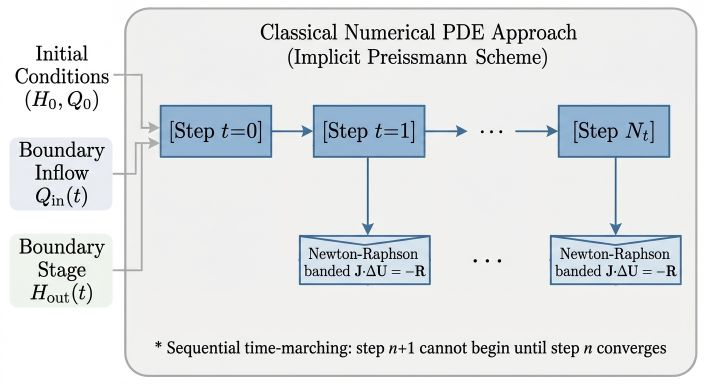
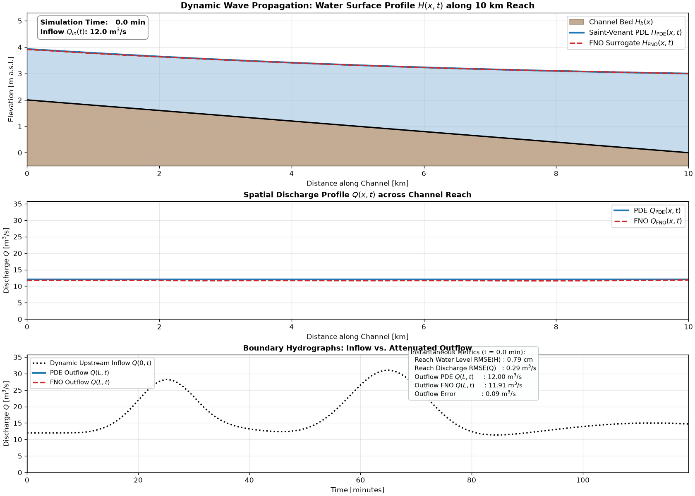

# Deep Learning for Physical Systems: A Fourier Neural Operator Surrogate for Open-Channel Flow

[](https://www.python.org/downloads/)
[](https://pytorch.org/)
[](https://opensource.org/licenses/MIT)
[](https://github.com/)

**Author:** Farid Alavi
**Domain:** Scientific Machine Learning (SciML), Fourier Neural Operators (FNO), Deep Operator Learning, Computational Hydraulics

---

## Abstract

1D Saint-Venant (shallow water) equations are the standard models for simulation of open-channel water networks (rivers, canals, irrigation systems). Although there are efficient solvers for these equations, they require sequential time-marching, limiting throughput when hundreds of scenarios must be evaluated for ensemble forecasting.

This project trains and benchmarks a 2D spatio-temporal Fourier Neural Operator (**FNO**) that maps boundary and initial conditions to the full space-time flow field of a specific channel reach. The FNO implements the following mapping:
$$\mathcal{G} _{\theta}: \big(H_0(x), Q_0(x), Q _{\text{in}}(t), H _{\text{out}}(t)\big) \mapsto \big(H(x, t), Q(x, t)\big)$$
where H is the water level, Q is the water flow, and the subscript 0 indicates the initial condition. The variables $x$ and $t$ represent the spatial and temporal coordinates, respectively.

The results show that the FNO surrogate can simulate the hydraulics of the channel with acceptable accuracy, with the following benefits:

1. **Reduced-Space Optimization with FNO:**
In traditional hydraulic optimization tools like RTC-Tools, the implicit discretization of the Saint-Venant 
equations couples adjacent spatial nodes, forcing the solver to include water level and discharge at every 
spatial grid point and time step as decision variables alongside thousands of nonlinear equality 
constraints, even when the control problem only concerns a few target locations. Replacing the numerical 
PDE with an FNO converts these implicit state equations into a smooth, explicit forward mapping from 
boundary controls to channel states. Consequently, all intermediate spatial states and physics equality 
constraints are completely eliminated from the optimization problem: the solver only optimizes over the 
boundary control inputs and evaluates state objectives or constraints at the few specific spatial locations 
of interest, drastically reducing the dimensionality of the nonlinear program and removing the need for 
homotopy continuation.

2. **Throughput under batching:** The FNO can evaluate many scenarios at once on a GPU for ensemble forecasting.

3. **Differentiability:** The FNO is implemented in PyTorch and is therefore differentiable end to end,
which makes it a suitable alternative to construct and solve nonlinear optimization problems (e.g. 
model-predictive control) with gradient-based methods.

---

## 1. Problem Statement

Water management infrastructure relies on predicting water surface elevation $H(x, t)$ and
discharge $Q(x, t)$ along canal and river reaches subjected to boundary inflows and control
structures.

In our case study, we use a single 10 km ($L = 10$ km) rectangular reach with a 10 m width ($B = 10$ m), a bed slope of 
$2\times10^{-4}$, and a Manning roughness of $n = 0.025$. The reach has a fixed upstream inflow hydrograph 
$Q_{\text{in}}(t)$ and a fixed downstream stage hydrograph $H_{\text{out}}(t)$.

In this project, we introduce two solutions to simulate the hydraulics of the channel reach: a classical numerical PDE solver and a deep learning surrogate using FNO neural networks.

---

## 2. Classical Numerical PDE Approach (Implicit Preissmann Scheme)

### Governing Equations

Open-channel flow in a prismatic rectangular reach of length $L$, width $B$, bed slope $S_0$, and Manning roughness $n$ is governed by the 1D Saint-Venant (shallow water) equations, which express the conservation of mass and momentum:

#### Conservation of mass
$$\frac{\partial A}{\partial t} + \frac{\partial Q}{\partial x} - q_{\text{lat}} = 0$$

#### Conservation of momentum
$$\frac{\partial Q}{\partial t} + \frac{\partial}{\partial x}\left(\frac{Q^2}{A}\right) + g A \frac{\partial H}{\partial x} + g A S_f = 0$$

where:
- $H(x, t)$ is the water surface elevation [m a.s.l.]
- $H_b(x) = h_{\text{bed,down}} + S_0 (L - x)$ is the bed elevation [m a.s.l.]
- $h(x, t) = H(x, t) - H_b(x)$ is the water depth [m]
- $A = B h$ is the wetted cross-sectional area [m²], and $R = A / (B + 2h)$ is the hydraulic radius [m]
- $S_f = n^2 |Q| Q / (A^2 R^{4/3})$ is the Manning friction slope [-]
- $q_{\text{lat}}$ is the lateral inflow per unit length [m²/s] ($q_{\text{lat}} = 0$ in this study)
- $g = 9.81\ \text{m/s}^2$ is gravitational acceleration

Several non-convex and nonlinear features govern the physical behavior of this system: quadratic bed friction with a non-smooth $|Q|Q$ transition near zero flow, convective acceleration $\partial_x (Q^2/A)$ that steepens wave fronts, and backwater curves that propagate downstream stage changes upstream across the reach.

### Solver Workflow



As illustrated in the workflow diagram above, the classical numerical solver ([src/saint_venant.py](src/saint_venant.py)) computes the space-time hydraulic state by stepping sequentially through time:

1. **Steady-State Initialization:**
   Before time-marching begins, physically consistent initial conditions $\big(H_0(x), Q_0(x)\big)$ are computed by `compute_steady_state`. This routine solves the stationary discrete momentum balance cell by cell from downstream to upstream using a bracketed Brent root-finding algorithm. It is the discrete counterpart of the gradually varied flow equation:
   $$\frac{\text{d}h}{\text{d}x} = \frac{S_0 - S_f}{1 - \text{Fr}^2}, \quad \text{Fr} = \frac{Q}{A\sqrt{g h}}$$
   Because this steady-state profile is exactly consistent with the spatial discretisation of the solver, trajectories initialised from it do not suffer from spurious start-up transients.

2. **Four-Point Implicit Preissmann Discretisation:**
   The reach is divided into $N_x$ spatial nodes ($\Delta x = L / (N_x - 1)$) and $N_t$ time steps ($\Delta t = T / N_t$). The partial derivatives and nonlinear terms in the Saint-Venant equations are approximated over each space-time box $(i, i+1) \times (n, n+1)$ using the Preissmann four-point implicit box scheme with temporal weighting factor $\theta = 0.60$.

3. **Sequential Time-Marching and Newton-Raphson Iteration:**
   Starting from the initial state at $t = 0$, the solver advances step by step ($t = 0 \to t = 1 \to \dots \to t = N_t$). At each time step $n+1$:
   - The upstream inflow boundary condition $Q(0, t_{n+1}) = Q_{\text{in}}(t_{n+1})$ and downstream stage boundary condition $H(L, t_{n+1}) = H_{\text{out}}(t_{n+1})$ are imposed.
   - The discretised mass and momentum conservation equations form a coupled system of $2N_x$ nonlinear algebraic residual equations $R(U^{n+1}) = 0$ for the interleaved unknown state vector $U^{n+1} = [H_0, Q_0, H_1, Q_1, \ldots, H_{N_x-1}, Q_{N_x-1}]^\top$.
   - This nonlinear system is solved iteratively using the Newton-Raphson method, updating the state via $J \cdot \Delta U = -R$ until convergence.

4. **Analytic Banded Jacobian:**
   Because each Preissmann cell residual only couples adjacent spatial nodes ($H_i, Q_i, H_{i+1}, Q_{i+1}$), the Newton system is **block-tridiagonal**, yielding a banded Jacobian matrix $J$ with lower and upper bandwidths $k_l = k_u = 2$. The solver assembles this Jacobian **analytically** using the exact partial derivatives of $A$, $Q^2/A$, and $S_f$ with respect to $H$ and $Q$, and solves the linear system in $O(N_x)$ operations per Newton iteration via `scipy.linalg.solve_banded`. Because step $n+1$ requires the converged state from step $n$ as its starting point, time steps must be executed strictly sequentially.

---

## 3. FNO Neural Network as a Surrogate

### Why Fourier Neural Operators?

Instead of stepping sequentially through time, the **Fourier Neural Operator (FNO)** ([Li et al., 2020](https://arxiv.org/abs/2010.08895)) formulates the PDE solution map as an operator between function spaces and parameterises the integral kernel directly in the frequency domain:

$$\big(\mathcal{K}(v)\big)(x) = \mathcal{F}^{-1} \Big( R \cdot \big(\mathcal{F}(v)\big) \Big)(x)$$

where $\mathcal{F}$ and $\mathcal{F}^{-1}$ denote the Fourier transform and its inverse, and $R$ is a learnable complex weight tensor truncated to the lowest Fourier modes. Applying a 2D spatio-temporal FNO to open-channel hydraulics is motivated by two architectural properties:

- **Global receptive field:** Backwater effects propagate upstream across the entire reach. A spectral convolution layer couples all spatial and temporal points in a single global operation, whereas a standard local convolution would require deep layer stacking to propagate information across the domain.
- **Resolution flexibility:** Because the learned kernel is defined on normalised continuous coordinates, the operator can in principle be queried on meshes with different spatial or temporal resolutions than the training grid.

Because neither the channel reach nor the inflow/stage hydrographs are periodic, the Fast Fourier Transform's implicit periodicity assumption would introduce boundary artifacts if applied directly. To address this, the implementation appends a 20% smooth cosine periodic bridge along both the spatial and temporal axes prior to the spectral layers—smoothly transitioning from $(x=L, t=T)$ back to $(x=0, t=0)$—and crops the output back to the physical domain afterwards ([src/fno.py](src/fno.py)).

### Surrogate Workflow

```
  1D Initial Conditions (space x)          1D Boundary Hydrographs (time t)        Space-Time Coordinates
  ┌─────────────────────────────┐          ┌──────────────────────────────┐        ┌────────────────────┐
  │ • Water level   H0(x) [Nx]  │          │ • Upstream inflow  Q_in(t)   │        │ • x / L ∈ [0, 1]   │
  │ • Discharge     Q0(x) [Nx]  │          │ • Downstream stage H_out(t)  │        │ • t / T ∈ [0, 1]   │
  └──────────────┬──────────────┘          └──────────────┬───────────────┘        └─────────┬──────────┘
                 │ Broadcast across t                     │ Broadcast across x               │
                 └───────────────────┐                    │                    ┌─────────────┘
                                     ▼                    ▼                    ▼
                          ┌──────────────────────────────────────────────────────────────┐
                          │ 1. Space-Time Input Tensor Assembly & Normalisation          │
                          │    6-channel 2D grid on (x, t): shape [Batch, Nx, Nt, 6]     │
                          │    [ H0(x), Q0(x), Q_in(t), H_out(t), x/L, t/T ]             │
                          └──────────────────────────────┬───────────────────────────────┘
                                                         │
                                                         ▼
                          ┌──────────────────────────────────────────────────────────────┐
                          │ 2. Pointwise Lifting & Non-Periodic Domain Padding           │
                          │    • Linear lifting: 6 channels ──► d = 64 latent channels   │
                          │    • Smooth cosine bridge pad (+20% along x and t) to avoid  │
                          │      FFT wrap-around cliffs at reach/time boundaries         │
                          └──────────────────────────────┬───────────────────────────────┘
                                                         │  v_0(x, t)
                                                         ▼
                          ┌──────────────────────────────────────────────────────────────┐
                          │ 3. 4 Sequential Spatio-Temporal Fourier Blocks (l = 0,1,2,3) │
                          │                                                              │
                          │    Input v_l(x, t) ──────────┬─────────────────────────────┐ │
                          │                              ▼                             ▼ │
                          │    ┌─────────────────────────────────┐   ┌─────────────────┐ │
                          │    │ 1. Spectral Path (Global)       │   │ 2. Residual Path│ │
                          │    │  • 2D rFFT: (x,t) ──► (kx,kt)   │   │    (Local)      │ │
                          │    │  • Multiply low modes: R_l · v̂  │   │  • 1×1 Linear   │ │
                          │    │  • 2D irFFT: (kx,kt) ──► (x,t)  │   │    Conv W_l·v_l │ │
                          │    └─────────────────┬───────────────┘   └────────┬────────┘ │
                          │                      └─────────────► (+) ◄────────┘          │
                          │                                       │                      │
                          │                                       ▼                      │
                          │                           GELU Activation ──► v_{l+1}(x, t)  │
                          │                 (Output v_{l+1} feeds into next block l+1)   │
                          └──────────────────────────────┬───────────────────────────────┘
                                                         │  v_4(x, t)
                                                         ▼
                          ┌──────────────────────────────────────────────────────────────┐
                          │ 4. Domain Cropping, MLP Projection & Denormalisation         │
                          │    • Crop padded margins back to physical grid [Nx, Nt]      │
                          │    • Pointwise MLP: d = 64 ──► 128 ──► 2 output channels     │
                          │    • Denormalise to physical units                           │
                          └──────────────────────────────┬───────────────────────────────┘
                                                         │
                                                         ▼
                          ┌──────────────────────────────────────────────────────────────┐
                          │ Full Space-Time Hydraulic Solution (All x and t at once)     │
                          │    • Water surface elevation  H(x, t)  [Batch, Nx, Nt]       │
                          │    • Channel discharge        Q(x, t)  [Batch, Nx, Nt]       │
                          └──────────────────────────────────────────────────────────────┘
```

As shown in the workflow diagram above, the FNO replaces sequential time-marching and iterative Newton-Raphson root-finding with a single non-iterative forward pass over the entire space-time domain:

1. **Space-Time Input Tensor Assembly & Normalisation:** The 1D spatial initial profiles $H_0(x)$ and $Q_0(x)$ (defined on $N_x$ nodes) are broadcast across all $N_t$ time steps, while the 1D temporal boundary hydrographs $Q_{\text{in}}(t)$ and $H_{\text{out}}(t)$ (defined on $N_t$ time steps) are broadcast across all $N_x$ spatial nodes. Stacking these with the normalised coordinate grids $x/L \in [0, 1]$ and $t/T \in [0, 1]$ produces a unified 6-channel 2D input tensor of shape $[\text{Batch}, N_x, N_t, 6]$, which is z-score normalised channel-wise ([src/dataset.py](src/dataset.py)).
2. **Pointwise Lifting & Non-Periodic Domain Padding:** A pointwise linear layer lifts the 6 input channels into a higher-dimensional latent space $v_0(x, t)$ of width $d = 64$. The latent grid is then padded by 20% on the right along both $x$ and $t$ using a raised-cosine bridge that smoothly transitions from $(x=L, t=T)$ back to $(x=0, t=0)$, preventing artificial FFT wrap-around cliffs.
3. **Spatio-Temporal Fourier Blocks (Global Coupling):** The padded latent field passes **sequentially** through 4 Fourier blocks ($\ell = 0, 1, 2, 3$). Inside **each individual block $\ell$**, the input $v_{\ell}(x, t)$ splits into two parallel paths that are summed and passed through a nonlinear activation before entering block $\ell + 1$:

   $$v _{\ell+1}(x, t) = \sigma\negthinspace\Big( \underbrace{\mathcal{F}^{-1}\negthinspace\big( R _{\ell} \cdot \mathcal{F}(v _{\ell}) \big)(x, t)} _{\text{1. Spectral Path (Global)}} + \underbrace{W _{\ell} \thinspace v _{\ell}(x, t)} _{\text{2. Residual Path (Local)}} \Big)$$

   - **Global spectral path:** A 2D real Fast Fourier Transform (`rfft2`) maps $v_{\ell}(x, t)$ into joint spatial-temporal frequency modes $(k_x, k_t)$. A learnable complex weight tensor $R_{\ell}$ filters the lowest $k_x = 16$ spatial and $k_t = 24$ temporal modes, and an inverse 2D real FFT (`irfft2`) maps the result back to the space-time domain, coupling every $(x, t)$ location globally in a single step.
   - **Local residual path:** A pointwise $1\times 1$ convolution $W_{\ell}$ mixes the 64 channels locally in the physical domain and preserves sharp, high-frequency features truncated by the spectral path.
   - **Sum & Activation:** Inside each block, the two paths are summed immediately and passed through $\sigma = \text{GELU}$ (for blocks $\ell = 0, 1, 2$; the final block $\ell = 3$ omits the activation before the projection head), producing $v_{\ell+1}(x, t)$ as the input to the next block.
4. **Domain Cropping, MLP Projection & Denormalisation:** After the 4th Fourier block, the 20% padding is cropped away to restore the original $(N_x, N_t)$ grid. A two-layer pointwise MLP ($64 \to 128 \to 2$) projects the latent features at every grid point into the two target variables, which are denormalised to yield the complete space-time water level $H(x, t)$ and discharge $Q(x, t)$ fields simultaneously.

### Architecture & Neural Operator Design

The key architectural and training specifications of the 2D FNO surrogate ([src/fno.py](src/fno.py)) are summarised below:

| Specification | Value |
| :--- | :--- |
| Input channels | 6: $\big[H_0(x),\ Q_0(x),\ Q_{\text{in}}(t),\ H_{\text{out}}(t),\ x/L,\ t/T\big]$ |
| Output channels | 2: $\big[H(x, t),\ Q(x, t)\big]$ |
| Spatial Fourier modes $k_x$ | 16 |
| Temporal Fourier modes $k_t$ | 24 |
| Latent channel width $d$ | 64 |
| Fourier layers | 4 sequential blocks, each with a parallel $1\times1$ convolutional bypass |
| Domain padding | 20% of the grid, right-sided smooth cosine periodic bridge along $x$ and $t$ |
| Projection head | 2-layer pointwise MLP ($64 \to 128 \to 2$) |
| Activation | GELU |
| Trainable parameters | 12,608,578 |
| Loss | Relative $L_2$ on z-scored fields (training objective only) |
| Optimiser | AdamW, lr $10^{-3}$, cosine annealing to $10^{-5}$, 300 epochs |

Channel-wise z-score normalisers for the inputs and outputs are fitted exclusively on the training partition and stored inside the model checkpoint.

### Synthetic Dataset Generation

To train and evaluate the neural operator, [src/generate_dataset.py](src/generate_dataset.py) drives the Preissmann reference solver with randomised boundary conditions:

1. **Initial condition:** For each trajectory, a baseline discharge $Q_{\text{base}} \sim \mathcal{U}(2, 60)\ \text{m}^3/\text{s}$ and downstream stage $H_{\text{down,base}} \sim \mathcal{U}(1.8, 5.0)\ \text{m}$ are drawn, and the corresponding steady-state backwater profile is computed via `compute_steady_state`.
2. **Boundary forcing $Q_{\text{in}}(t)$, $H_{\text{out}}(t)$:** Sampled from four hydrograph families (with probabilities 40%, 30%, 15%, 15%):
   - **Gaussian processes (40%):** Smooth RBF-kernel trajectories around the baseline flow and stage.
   - **Multi-event control transitions & pulses (30%):** 1–3 operational events combining fast raised-cosine S-curve transitions (6–15 min), gradual S-curve ramps (15–30 min), and smooth $\sin^2$ pulses.
   - **Harmonic fluctuations (15%):** Sinusoidal waves with randomised periods (1–4 h for $Q_{\text{in}}$, 2–6 h for $H_{\text{out}}$) and phases.
   - **Synthetic flood waves (15%):** A Gaussian flood wave superposed on $Q_{\text{base}}$, paired with a smooth Gaussian-process drift on $H_{\text{out}}(t)$.
3. **Grid dimensions and split:** 1,000 trajectories simulated at $N_x = 51$ ($\Delta x = 200$ m) and $N_t = 120$ ($\Delta t = 60$ s, total duration $T = 2$ h). The dataset is partitioned into 800 training, 100 validation, and 100 test trajectories using a fixed seeded permutation.
4. **Deterministic reproducibility:** Each candidate trajectory draws its random parameters from an independent `SeedSequence` stream keyed by its sample ID. All 1,500 candidate IDs are simulated across parallel worker processes, and the accepted dataset consists of the 1,000 lowest sample IDs that converged. Consequently, the generated dataset and train/validation/test split are invariant to multi-process worker scheduling.

---

## 4. Results of the Numerical Experiments

### Implementation Details of the Two Approaches

- **Classical Numerical PDE Implementation ([src/saint_venant.py](src/saint_venant.py)):**
  The reference Preissmann solver ($\theta = 0.60$) is implemented in Python using NumPy and SciPy, assembling the analytic block-tridiagonal Jacobian ($k_l = k_u = 2$) in vectorised form and solving each Newton step via `scipy.linalg.solve_banded`. To verify correctness, the analytic Jacobian was validated against a central-difference Jacobian of an independently written residual assembly; the two agree to $\sim 10^{-9}$ (the finite-difference truncation floor), with zero entries outside the assumed band.
  
  This implementation detail is critical for honest benchmarking. An earlier implementation built the Jacobian via finite differences ($2N_x + 1$ residual evaluations per iteration in a Python loop, followed by a dense $O(N_x^3)$ linear solve), which required **5,870 ms** per trajectory compared to **32.5 ms** for the analytical banded solver — a factor of ~180. Benchmarking a neural surrogate against an unoptimised finite-difference solver manufactures an artificial speedup that says nothing about the underlying numerical method. During dataset generation, 1,498 of 1,500 candidate trajectories converged (99.9%); the only two rejections had supercritical downstream boundaries, which cannot be represented by a prescribed downstream stage formulation. At a 99.9% acceptance rate, filtering does not measurably bias the dataset toward easy scenarios.

- **FNO Surrogate Implementation ([src/fno.py](src/fno.py), [src/train.py](src/train.py), [src/evaluate.py](src/evaluate.py)):**
  The 2D FNO is implemented in PyTorch using `torch.fft.rfft2` and `torch.fft.irfft2`. It is trained for 300 epochs (batch size 16) with AdamW (`lr = 1e-3`, cosine annealing to `1e-5`). All runtime and accuracy benchmarks evaluate both methods on the exact same end-to-end task: given NumPy arrays for $\big(H_0, Q_0, Q_{\text{in}}, H_{\text{out}}\big)$, return $\big(H(x, t), Q(x, t)\big)$ as NumPy arrays. For the FNO, timing measurements include 6-channel tensor assembly, host-to-device transfer, input normalisation, the neural network forward pass, output denormalisation, and device-to-host transfer. All experiments were executed on an Intel Core i7-13650HX CPU and an NVIDIA GeForce RTX 4060 Laptop GPU.

### How Accuracy Is Measured

A single accuracy definition is used consistently across all evaluations ([src/metrics.py](src/metrics.py)):

$$\varepsilon = \frac{\lVert u_{\text{pred}} - u_{\text{ref}} \rVert_2}{\lVert u_{\text{ref}} - u_{\text{ref}}(t=0) \rVert_2}$$

The denominator is the **dynamics** — the reference trajectory's deviation from its own initial profile $u_{\text{ref}}(t=0)$ — rather than the raw field norm $\lVert u_{\text{ref}} \rVert_2$. In open-channel hydraulics, water surface elevation $H(x, t)$ carries a 3–5 m datum offset above sea/bed level; normalising by the raw field allows that static offset to dominate the denominator and artificially deflates the reported relative error by roughly an order of magnitude. For example, a 4 cm prediction error on a reach where the water level varies by 40 cm is a 10% error on the dynamics, not a 1% error.

The relative $L_2$ loss computed on z-scored tensors during training is strictly an optimisation objective; it is reported separately and is never quoted as a physical accuracy figure.

### Summary of Benchmark Results

| Evaluation Criterion | Result |
| :--- | :--- |
| Accuracy on 100 held-out trajectories | **2.66%** relative $L_2$ (dynamics-normalised); **0.42 cm** water-level RMSE, **0.103 m³/s** discharge RMSE |
| Throughput vs. the reference solver | **0.32×** (i.e. slower) single-trajectory on CPU; **4.96×** single-trajectory on GPU; **23.5×** faster for a batch of 16 on GPU |
| Volume conservation | **0.52%** mean (5.04% worst-case) vs. **0.04%** for the solver |
| Flood peak tracking | **0.32%** peak discharge error, **90 s** (1.5 time steps) mean arrival-time error over 16 flood-wave cases |
| Temporal mesh invariance | **Holds**: 2.03% $\to$ 2.23% at 2× temporal refinement, zero-shot |
| Spatial mesh invariance | **Holds**: 2.03% $\to$ 2.18% at 2×–4× spatial refinement (2.36% at 4× space $\times$ 2× time, 1.16× change) |

### Detailed Benchmark Results

#### 1. Accuracy on the Held-Out Test Set

Evaluated across all 100 unseen test trajectories ([src/evaluate.py](src/evaluate.py)):

| Metric | Value |
| :--- | :---: |
| Relative $L_2$, water level $H$ | **2.51%** |
| Relative $L_2$, discharge $Q$ | **2.80%** |
| Relative $L_2$, overall | **2.66%** |
| $H$ RMSE / MAE / max abs | **0.42 cm** / 0.24 cm / 7.05 cm |
| $Q$ RMSE / MAE / max abs | **0.103** / 0.057 / 2.41 m³/s |
| Training objective (normalised rel. $L_2$) | $4.04\times10^{-3}$ |

Across the 100 held-out test trajectories, the domain-wide RMSE is **0.42 cm** for water surface elevation and **0.103 m³/s** for discharge (2.66% overall dynamics-normalised relative $L_2$ error), with worst-case pointwise deviations of 7.05 cm and 2.41 m³/s occurring during the steepest multi-event control transitions.

#### 2. Physical Fidelity

Evaluated by [src/benchmark_physics_and_speed.py](src/benchmark_physics_and_speed.py) across the 100 test trajectories:

| Metric | FNO Surrogate | Preissmann Solver |
| :--- | :---: | :---: |
| Volume conservation error (mean / max) | **0.52% / 5.04%** | 0.04% / 0.18% |
| Downstream peak discharge error | **0.32%** | — |
| Peak arrival timing error | **90.0 s** (1.5 time steps) | — |

Wave-tracking metrics (peak discharge and peak arrival time) are evaluated specifically on the 16 flood-wave trajectories in the test split. Computing a single "peak arrival time" on a Gaussian-process or sinusoidal hydrograph is ill-posed because `argmax` over a multi-modal or near-flat series is dominated by minor fluctuations rather than a distinct flood crest.

For volume conservation, the Preissmann solver's residual (0.04% mean) is non-zero only because the benchmark script integrates channel storage using the composite trapezoidal rule whereas the Preissmann scheme uses $\theta$-weighted box averaging. That 0.04% represents the numerical quadrature floor, and the unconstrained FNO surrogate averages 0.52% across the test set.

#### 3. Latency and Throughput

Measured on an Intel Core i7-13650HX CPU and an NVIDIA GeForce RTX 4060 Laptop GPU:

**Base Grid ($N_x = 51,\ N_t = 120$):**

| Method | Hardware | Time per trajectory | vs. baseline |
| :--- | :--- | :---: | :---: |
| **Preissmann solver** | CPU (i7-13650HX, 1 thread) | 28.38 ms | 1.00× (baseline) |
| FNO, single trajectory | CPU (i7-13650HX, 1 thread) | 88.54 ms | **0.32×** (slower) |
| FNO, single trajectory | CPU (i7-13650HX, 14 threads) | 81.57 ms | **0.35×** (slower) |
| FNO, batch of 16 | CPU (i7-13650HX, 14 threads) | 19.54 ms | 1.45× |
| FNO, single trajectory | GPU (RTX 4060 Laptop) | 5.73 ms | 4.96× |
| **FNO, batch of 16** | GPU (RTX 4060 Laptop) | **1.21 ms** | **23.5×** |

**Latency Scaling Across Spatial ($N_x$) and Temporal ($N_t$) Discretisations:**

Because the Preissmann solver marches sequentially through $N_t$ time steps and solves a $2N_x$-variable banded Newton system at each step, its runtime scales strongly with $N_t$ and modestly with $N_x$ (where vectorised NumPy operations amortise fixed Python loop overhead). For the FNO, while the spectral mode multiplication operates on a fixed number of modes ($k_x = 16, k_t = 24$), the 2D FFTs (`rfft2`/`irfft2`), pointwise $1\times 1$ convolutions, and host-device transfers scale with the total number of grid points $B \cdot N_x \cdot N_t$:

| Grid ($N_x \times N_t$) | $\Delta x$ | $\Delta t$ | Preissmann Solver (CPU 1T) | FNO Single (CPU 14T) | FNO Single (GPU) | FNO Batch 16 (GPU) | Speedup (GPU Single) | Speedup (GPU Batch 16) |
| :---: | :---: | :---: | :---: | :---: | :---: | :---: | :---: | :---: |
| $51 \times 120$ | 200 m | 60 s | `21.92 ms` | `83.48 ms` | `7.66 ms` | `1.21 ms` | `2.9×` | `18.1×` |
| $51 \times 240$ | 200 m | 30 s | `41.04 ms` | `90.11 ms` | `9.16 ms` | `2.25 ms` | `4.5×` | `18.2×` |
| $101 \times 120$ | 100 m | 60 s | `26.37 ms` | `88.81 ms` | `9.11 ms` | `2.24 ms` | `2.9×` | `11.8×` |
| $101 \times 240$ | 100 m | 30 s | `45.17 ms` | `101.71 ms` | `8.32 ms` | `4.35 ms` | `5.4×` | `10.4×` |
| $201 \times 120$ | 50 m | 60 s | `30.78 ms` | `101.40 ms` | `10.83 ms` | `4.33 ms` | `2.8×` | `7.1×` |
| $201 \times 240$ | 50 m | 30 s | `57.14 ms` | `131.66 ms` | `7.91 ms` | `8.53 ms` | `7.2×` | `6.7×` |

#### 4. Zero-Shot Super-Resolution & Mesh Invariance

Using [src/benchmark_super_resolution.py](src/benchmark_super_resolution.py), the checkpoint trained exclusively at $51 \times 120$ ($\Delta x = 200$ m, $\Delta t = 60$ s) was evaluated zero-shot across finer spatial ($N_x \in \{51, 101, 201\}$) and temporal ($N_t \in \{120, 240\}$) grids without retraining. On each target mesh, initial conditions are recomputed directly on that grid via `compute_steady_state` (avoiding interpolation-induced start-up transients), and errors are measured against a converged fine-grid reference solution ($801 \times 960$) subsampled onto the evaluation mesh. Across all six meshes (up to $4\times$ spatial and $2\times$ temporal refinement), the FNO's relative $L_2$ error remains tightly bounded between **2.03%** ($51 \times 120$) and **2.36%** ($201 \times 240$, a $1.16\times$ change), with water-level RMSE constant at **0.42–0.43 cm** and discharge RMSE constant at **0.099–0.104 m³/s** (compared to the Preissmann solver's own discretisation error of 0.22%–0.68% across the same meshes).

### Discussion of the Results

1. **Throughput, Single-Shot Latency, and Grid Resolution Scaling:**
   The central performance finding is that the FNO's speed advantage is governed by GPU memory-bandwidth saturation ($B \cdot N_x \cdot N_t$ total space-time points) and the Preissmann solver's sequential time-stepping overhead:
   - **Base-grid batching and GPU saturation:** On the $51 \times 120$ grid ($6{,}120$ points per trajectory), a single trajectory (`5.73 ms`, **4.96×** speedup) under-utilises the RTX 4060 Laptop GPU. Batching 8–16 trajectories ($\approx 49{,}000$–$98{,}000$ total grid points) fills the GPU's 32 MB L2 cache and 256 GB/s memory bus, reducing the amortised runtime to **1.21 ms per trajectory (23.5× speedup)**. Increasing the batch size further to 32, 64, or 128 yields essentially the same amortised time (~1.12–1.16 ms/trajectory) because the GPU is already memory-bandwidth bound.
   - **Why Single-GPU speedup increases with grid size (`2.9×` $\to$ `7.2×`) while Batch-16 speedup decreases (`18.1×` $\to$ `6.7×`):**
     1. *GPU saturation by a single fine-grid trajectory:* A single trajectory on the $201 \times 240$ grid contains $48{,}240$ space-time points—the exact same workload as a batch of 8 trajectories on the $51 \times 120$ grid ($48{,}960$ points). Consequently, for single-trajectory GPU inference, refining the grid by $8\times$ simply absorbs idle GPU capacity, keeping FNO runtime flat (`7.66 ms` $\to$ `7.91 ms`) while the Preissmann solver slows down (`21.92 ms` $\to$ `57.14 ms`), so single-trajectory speedup grows from `2.9×` to `7.2×`. Conversely, because a single $201 \times 240$ trajectory already saturates the GPU, batching 16 of them provides no additional parallel efficiency: the 2D FFTs, $1\times 1$ convolutions, and PCIe transfers scale linearly with $N_x \cdot N_t$ (`1.21 ms` $\to$ `8.53 ms`), converging to the single-trajectory rate.
     2. *Temporal ($N_t$) vs. spatial ($N_x$) scaling of the Preissmann baseline:* In the Preissmann solver, doubling the number of sequential time steps $N_t$ ($120 \to 240$) nearly doubles CPU runtime (`21.92 ms` $\to$ `41.04 ms`), so the Batch-16 FNO speedup remains constant (`18.1×` $\to$ `18.2×`). However, quadrupling spatial nodes $N_x$ ($51 \to 201$) increases CPU runtime by only ~40% (`21.92 ms` $\to$ `30.78 ms`) because Python loop dispatch dominates at small $N_x$ and vectorised NumPy/LAPACK banded solves absorb the larger spatial array with minimal extra cost, whereas the bandwidth-saturated GPU must process $4\times$ more grid points in VRAM.

2. **Temporal and Spatial Mesh Invariance:**
   The zero-shot super-resolution experiments demonstrate that both temporal and spatial mesh invariance hold across the tested refinements:
   - **Temporal super-resolution ($2\times$):** Doubling the temporal resolution ($\Delta t$: 60 s $\to$ 30 s) changes the relative $L_2$ error by only 0.20 percentage points (2.03% $\to$ 2.23%), with water-level RMSE virtually unchanged (0.42 cm $\to$ 0.43 cm).
   - **Spatial super-resolution ($2\times$–$4\times$):** Refining the spatial mesh from $\Delta x = 200$ m to 100 m and 50 m changes the relative $L_2$ error from 2.03% to **2.15%** and **2.18%**, while water-level RMSE (0.42 cm) and discharge RMSE (0.099–0.100 m³/s) remain constant. Even under simultaneous $4\times$ spatial and $2\times$ temporal refinement ($201 \times 240$), the surrogate error increases by only 1.16× (2.03% $\to$ 2.36%), confirming that the FNO has learned a resolution-consistent continuous operator representation.

3. **Physical Conservation vs. Purely Data-Driven Training:**
   Even though the FNO is trained purely with a data-driven $L_2$ regression loss without hard boundary projections or physics-informed conservation penalties, its mean volume conservation error is *0.52%* (with a 5.04% worst case), and it tracks downstream flood peaks to within *0.32%* mean amplitude error and *90 s* (1.5 time steps) arrival-time error. While millimeter-scale water-level RMSE (0.42 cm) is well suited for rapid scenario screening, ensemble forecasting, and reduced-space optimisation, applications requiring strict machine-precision mass balance closure must still account for this conservation residual.

### Case Study: Dynamic Multi-Peak Flood Wave
- **Scenario:** A multi-event inflow hydrograph starting from a $12\ \text{m}^3/\text{s}$ baseflow, followed by an antecedent peak of $\approx 25\ \text{m}^3/\text{s}$ at $t = 25$ min and a steep main flood wave of $\approx 35\ \text{m}^3/\text{s}$ at $t = 65$ min with gradual recession.
- **Result:** **3.40%** overall relative $L_2$ error (3.03% on $H$, 3.76% on $Q$); $H$ RMSE of **0.64 cm** (MAE 0.49 cm, max 2.25 cm); $Q$ RMSE of **0.173 m³/s** (MAE 0.138 m³/s, max 0.552 m³/s).
- **Timing:** 29.7 ms (Preissmann solver, CPU 1 thread) vs. 2.67 ms (FNO, GPU) — **11.1×** speedup.
- **Outputs:** Static comparison plots and a synchronised GIF animation showing the water surface profile, spatial discharge profile, and inflow/outflow hydrographs.
- **Run:** `python case_studies/dynamic_inflow/run_dynamic_inflow.py`
- **Render:** `python case_studies/dynamic_inflow/animate_dynamic_inflow.py --filename dynamic_inflow_comparison.gif`



---

## 5. Repository Structure

```
Github_repository/
├── README.md
├── requirements.txt
├── LICENSE
├── data/
│   └── saint_venant_dataset.npz        # 1,000 Saint-Venant trajectories + hydrograph labels
├── models/
│   └── fno_saint_venant.pt             # Trained FNO (+ normalisers, model args)
├── results/
│   └── benchmark_physics_and_speed.json
├── figures/
├── case_studies/
│   └── dynamic_inflow/
└── src/
    ├── saint_venant.py                 # Preissmann solver, analytic banded Jacobian
    ├── generate_dataset.py             # Deterministic multi-process dataset generation
    ├── dataset.py                      # PyTorch Dataset & 6-channel tensor assembler
    ├── fno.py                          # 2D FNO with non-periodic domain padding
    ├── metrics.py                      # Single shared accuracy metric definition
    ├── train.py                        # Training loop
    ├── evaluate.py                     # Checkpoint evaluation on the test split
    ├── benchmark_physics_and_speed.py  # Conservation, wave tracking, like-for-like latency
    ├── benchmark_super_resolution.py   # Mesh invariance vs. a converged reference
    └── visualize.py
```

---

## 6. Quickstart

### Regenerate data and retrain

```bash
python src/generate_dataset.py --num-samples 1000 --num-workers 12 --output-path data/saint_venant_dataset.npz
python src/train.py --data-path data/saint_venant_dataset.npz --epochs 300 --batch-size 16
```

Dataset generation is deterministic given `--num-samples`, so the split and the reported numbers are reproducible. The bundled dataset and checkpoint were produced by these two commands.

### Evaluate the pre-trained model

```bash
python src/evaluate.py --data-path data/saint_venant_dataset.npz --checkpoint-path models/fno_saint_venant.pt
```

### Reproduce the benchmarks

```bash
python src/benchmark_physics_and_speed.py --num-samples 100 --results-path results/benchmark_physics_and_speed.json
python src/benchmark_super_resolution.py --num-samples 15
```

---

## 7. License & Citation

MIT License — see [LICENSE](LICENSE).

```bibtex
@software{alavi2026fno_hydraulics,
  author = {Farid Alavi},
  title  = {A Fourier Neural Operator Surrogate for 1D Open-Channel Flow},
  year   = {2026},
  url    = {https://github.com/FaridAlavi/fourier-neural-operator-hydraulic-surrogate}
}
```

