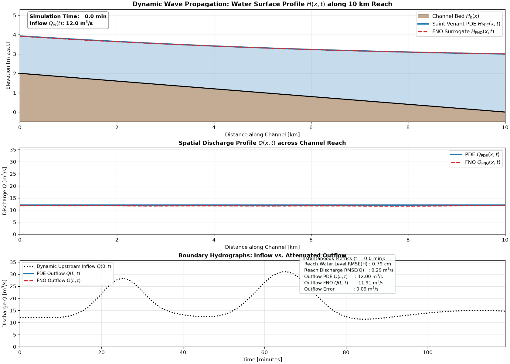

# Case Study: Dynamic Inflow Hydrograph (PDE vs. FNO Surrogate)

This case study evaluates the Fourier Neural Operator (FNO) surrogate model against the Preissmann implicit 1D Saint-Venant PDE solver under a complex, dynamic unsteady inflow regime.

---

## 1. Scenario Description

- **Channel Geometry**: Prismatic rectangular open channel reach ($L = 10\text{ km}$, $B = 10\text{ m}$, $S_0 = 0.0002$, $n = 0.025$).
- **Boundary Conditions**:
  - **Dynamic Inflow $Q(0, t)$**: An unsteady multi-event hydrograph with initial baseflow ($12\text{ m}^3/\text{s}$), a moderate antecedent peak ($Q \approx 25\text{ m}^3/\text{s}$ at $t \approx 25\text{ min}$), followed by a steep flood wave ($Q \approx 35\text{ m}^3/\text{s}$ at $t \approx 65\text{ min}$) and gradual recession.
  - **Downstream Water Level $H(L, t)$**: Constant downstream control level $H(L) = 3.0\text{ m}$.
- **Spatio-Temporal Discretization**: $N_x = 51$ spatial grid points, $N_t = 120$ time steps ($2\text{ hours}$ total duration, $\Delta t = 60\text{ s}$).

---

## 2. Key Findings and Quantitative Metrics

| Metric | Saint-Venant PDE Solver | FNO Surrogate | Comparison |
| :--- | :---: | :---: | :---: |
| **Execution Time** | $29.7\text{ ms}$ (CPU, 1 thread) | $2.67\text{ ms}$ (GPU) | **$11.1\times$** |
| **Water Level RMSE ($H$)** | — | — | **$0.64\text{ cm}$** |
| **Discharge RMSE ($Q$)** | — | — | **$0.173\text{ m}^3/\text{s}$** |
| **Overall Relative $L_2$ Error**| — | — | **$3.40\%$** |

The relative $L_2$ error is normalised by the reference dynamics (deviation from the initial
profile), per [src/metrics.py](../../src/metrics.py). The solver baseline uses an analytic banded
Jacobian, so the timing ratio reflects hardware and batching rather than an unoptimised reference.
The two sides run on different hardware; see the main README for a like-for-like CPU comparison,
in which single-trajectory FNO inference is slower than the solver.

---

## 3. Visualizations and Artifacts



- **GIF Animation**: [dynamic_inflow_comparison.gif](dynamic_inflow_comparison.gif)
  - **Top Panel**: Spatial water surface profile $H(x, t)$ dynamically propagating over the channel bed.
  - **Middle Panel**: Spatial discharge profile $Q(x, t)$ illustrating wave front movement and physical flood wave attenuation.
  - **Bottom Panel**: Boundary discharge hydrographs showing upstream inflow $Q(0, t)$ and attenuated downstream outflow $Q(L, t)$ with synchronized moving cursor and point-in-time metrics.
- **Spatio-Temporal Error Contours**: [figures/dynamic_inflow_spatiotemporal.png](figures/dynamic_inflow_spatiotemporal.png)
- **Multi-Station Hydrographs**: [figures/dynamic_inflow_station_hydrographs.png](figures/dynamic_inflow_station_hydrographs.png)
- **Summary Metrics**: [results_summary.json](results_summary.json)

---

## 4. Running the Case Study

```powershell
# 1. Run simulation, benchmark, and generate figures
python case_studies/dynamic_inflow/run_dynamic_inflow.py

# 2. Render GIF animation
python case_studies/dynamic_inflow/animate_dynamic_inflow.py --filename dynamic_inflow_comparison.gif --fps 15
```
